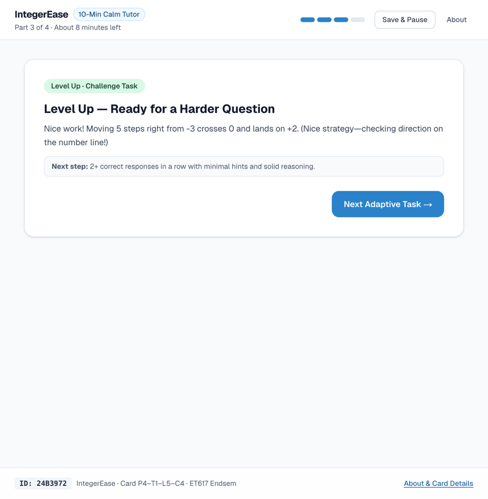
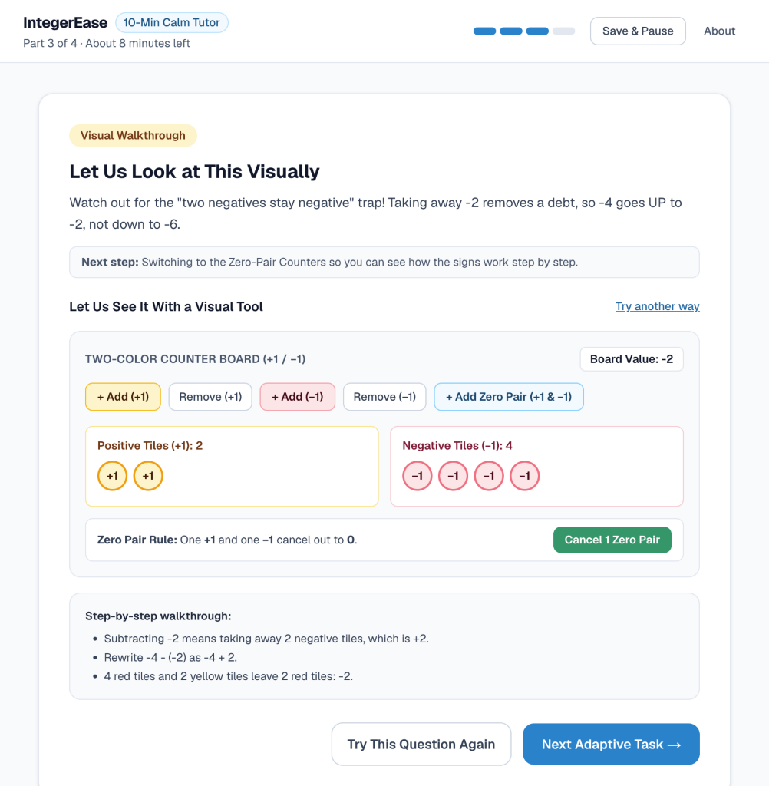
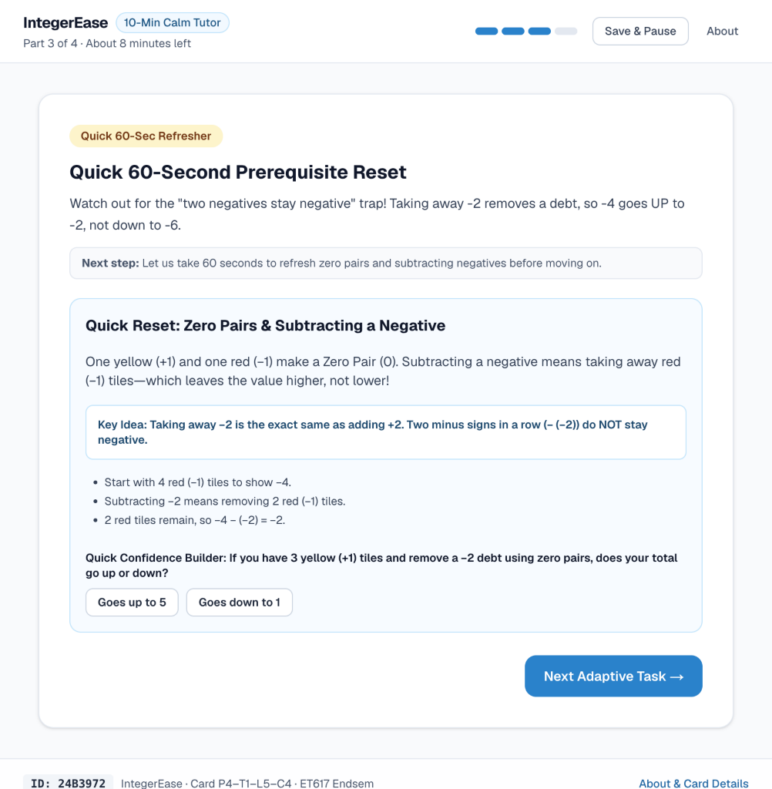

# ET 617-2026 End-Semester Examination Report

---

## Identity Card

| Field | Value |
|---|---|
| **Roll Number (Identity Token)** | `24B3972` |
| **Exam Card** | `P4 – T1 – L5 – C4` |
| **P4 – Problem Statement** | Adaptive tutor with automatic question generation |
| **T1 – Topic** | Integers: operations with negative numbers (Class 7) |
| **L5 – Learner Context** | Learner repeating the topic after failing it once, high anxiety and low self-efficacy |
| **C4 – Design Constraint** | 10-minute sessions (one complete sequence fits in 10 minutes; stop and resume where left off) |
| **Live App URL** | https://et617-24b3972.vercel.app |
| **GitHub Repository** | https://github.com/rushilbhat01/ET617-Endsem-24B3972 |

---

## D1. Educational Problem, Learning Outcomes & Context of Use

### Educational Problem
Class 7 learners who are repeating *Integers: operations with negative numbers* often rely on memorized, fragile sign rules (such as *"two negatives make a negative"*) rather than understanding direction on a number line or zero-pair cancellation. When they apply these rules inconsistently, they make recurring sign errors—especially when subtracting negative numbers or comparing two negative values. Traditional practice platforms mark these errors with punitive red indicators and generic hints, which deepens math anxiety and lowers self-efficacy for repeat learners. An adaptive tutor that diagnoses *why* a learner got an integer operation wrong, switches to visual representations when needed, and structures practice into calm 10-minute sessions can rebuild both conceptual understanding and confidence.

### Measurable Learning Outcomes
By the end of a 10-minute session, the learner will be able to:
1. **Compare & Represent** positive and negative integers on a number line and with two-color counters to explain why `-2 > -5`.
2. **Compute & Predict** sums and differences of signed integers (including subtracting a negative integer, e.g., `-4 - (-2)`) using zero-pair or number-line reasoning.
3. **Justify & Debug** an integer operation in their own words, identifying and correcting common sign misconceptions.

### Context of Use
- **Where:** At home or in an after-school study corner.
- **When:** Short evening study blocks (~10 minutes per session), with the ability to pause and resume mid-session.
- **Device:** Personal or parent's mid-range Android smartphone or home laptop browser.

---

## D2. Learner Persona (Expanded from L5)

- **Name & Age:** Aarav Kulkarni, 13 years old (Class 7).
- **Academic Background:** Repeating the *Integers* unit after failing his mid-term unit test (`L5`).
- **Prior Knowledge (Prerequisites):** Fluent in whole-number addition and subtraction (`0` to `100`) and familiar with real-world contexts like temperatures below zero or elevator floors, but uncertain about ordering two negative numbers (`-8` vs `-3`) and unfamiliar with *zero pairs* (`+1 + -1 = 0`).
- **Two Likely Misconceptions:**
  1. **M1 (`M1_MAGNITUDE_SIGN`) — Magnitude-Over-Sign / Direction Gap:** Treats `-8` as greater than `-3` because `8 > 3`, moves the wrong direction on the number line, or gets the right magnitude with the wrong sign (e.g., `2 + (-5) = +3`).
  2. **M2 (`M2_DOUBLE_NEGATIVE`) — Overgeneralized Sign Rule:** Believes *"two negatives always make a negative"* (e.g., `-4 - (-2) = -6`) or assumes subtraction always makes the result smaller.
- **Device, Time & Language:** Mid-range Android phone or shared laptop for 10–15 minutes in the evening (`C4`); English-medium school, prefers short, conversational everyday English (`C3` rubric).
- **Motivation & Affect:** High math anxiety and low self-efficacy (*"I always mess up the minus signs"*). Shuts down when shown timed countdowns that feel like tests or harsh red error screens; responds well to low-stakes encouragement, worked examples, peer-debugging tasks, and pre–post confidence reflection.

---

## D3. Educational Content

### Concept Explanation
Written in a calm, conversational style (*"Let us picture..."*), the tutor pairs two concrete tools (`T6` rubric) with specific conceptual gaps:
- **Interactive Number Line (`-10` to `+10`):** Numbers further right are always larger (`-3 > -8`). Adding a positive moves RIGHT; adding a negative moves LEFT. Keyboard arrows, step buttons, and live movement descriptions ensure full accessibility.
- **Two-Color Counter Board (`+1` Yellow / `−1` Red):** One `+1` and one `−1` form a **Zero Pair (`0`)**. Subtracting a negative means taking away red `−1` tiles (adding a zero pair first if needed), which leaves the total *higher*.

### Sample Learning Tasks (5 Formats, Curated + AI-Generated)

| # | Format | Task Prompt | Model Answer | Correct Feedback (with Strategy Praise) | M1 Feedback | M2 Feedback |
|---|---|---|---|---|---|---|
| **1** | **Number-Line Jump** | Start at `-3`. Move to show `-3 + 5`. | `+2` | *"Nice work! Moving 5 steps right from -3 crosses 0 and lands on +2. (Nice strategy—checking direction on the number line!)"* | *"Let us check the direction: +5 moves RIGHT (towards warmer numbers), not left. Try stepping 3 to 0, then 2 more!"* | *"Notice there is only one negative number here (-3). Adding +5 moves right."* |
| **2** | **Counter Board (Zero Pairs)** | Build `2 + (-5)` using `+1` and `−1` tiles, pair up zero pairs, and see what is left. | `-3` | *"Spot on! Two (+1, -1) zero pairs cancel out, leaving 3 red (-1) tiles = -3. (Great strategy—using zero pairs to see what cancels!)"* | *"You found the difference (3), but look at the color left over: 3 red (-1) tiles remain, so the answer is -3, not +3."* | *"Adding -5 puts 5 red tiles on the board alongside 2 yellow tiles—they partially cancel instead of stacking to -7."* |
| **3** | **Step-by-Step Numeric** | Solve `-4 - (-2)` in two calm steps (Step 1: rewrite using addition; Step 2: final value). | `-4 + 2` → `-2` | *"Great job! Taking away 2 red (-1) tiles from -4 leaves -2. (Solid method—rewriting step by step keeps signs clear!)"* | *"Check the sign: -4 has 4 red tiles and +2 only cancels 2 of them, so 2 red tiles (-2) remain."* | *"Watch out for the 'two negatives stay negative' trap! Taking away -2 removes a debt, so -4 goes UP to -2, not down to -6."* |
| **4** | **Error-Spotting (Peer Debug)** | Rohan wrote: `-6 - (-3) = -6 - 3 = -9`. Spot what went wrong! | He treated `-(-3)` as `-3` instead of `+3`; answer is `-3`. | *"Sharp eye! Spotting that -(-3) means +3 (moving right to -3) shows real mastery."* | *"Careful with the sign: from -6, moving 3 steps right only reaches -3, not +3."* | *"That is a very common trap! Subtracting -3 removes 3 red tiles, so -6 moves UP to -3, not down to -9."* |
| **5** | **Written Explanation (AI-Evaluated)** | In your own words (1–2 sentences), why does `3 - (-2)` give `5` instead of `1`? | Removing `-2` increases `3` by `2` (`3 + 2 = 5`). | *"Clear reasoning! You explained why taking away a negative increases the value."* | *"Your answer mixes up +2 and -2. Picture 3 yellow tiles and add 2 zero pairs to see what happens when you remove -2."* | *"Notice you treated -(-2) like subtracting 2. Removing a -2 debt leaves you with MORE (5), not less (1)."* |

---

## D4. Working Application

- **Live URL:** https://et617-24b3972.vercel.app
- **About & Viva Controls URL:** https://et617-24b3972.vercel.app/about
- **Identity Token:** `ID: 24B3972` is rendered in the persistent footer of every screen and on `/about`.
- **C4 Implementation:** Calm segmented progress (`Part X of 4 · About Y minutes left`), **Save & Pause** button on active screens, and versioned `localStorage` persistence (`et617_24b3972_session_v1`) that restores exact screen, task, misconception counts, and active elapsed time (excluding paused time).

### Screen / State Map (6 Connected States on `/` + `/about`)
1. **Welcome / Resume (`WELCOME`):** Introduces the calm 10-minute session; shows **Resume Where You Left Off** if a saved session exists.
2. **Low-Stakes Diagnostic (`DIAGNOSTIC` — Part 1 of 4):** Dynamically randomized negative-integer comparison and subtraction-of-negative items, plus an unbiased confidence check (no default selection).
3. **Targeted Concept Warm-up (`WARMUP` — Part 2 of 4):** Shows *only* the visual tool matched to the diagnostic (`NumberLineTool` for ordering gaps; `CounterBoardTool` for subtraction gaps), with a *"Try another way"* toggle.
4. **Adaptive Practice (`PRACTICE` — Part 3 of 4):** Serves tasks across all 5 formats with zero repeats, tracks `responseTimeMs` and `hintsUsed`, and provides **← Review Warm-up**, **See Similar Example**, **Gentle Hint**, and **Try Another Question**.
5. **Adaptive Feedback & Branching (`ADAPTIVE_FEEDBACK`):** Displays learner-friendly feedback (`Level Up · Challenge Task`, `Visual Walkthrough` with interactive tools + *Try This Question Again*, `Quick 60-Sec Refresher` prerequisite micro-lesson, or `Quick Double-Check`).
6. **10-Minute Session Summary (`SUMMARY` — Part 4 of 4):** Displays active study time, tasks completed, highest level reached, and a **Pre–Post Confidence Check** showing the learner's confidence journey.
7. **About & Viva Controls (`/about`):** Identity card, **Session & Viva Demo Controls** (`Start Correct-Response Path`, `Start M1 Path`, `Start M2 Path`, `Start a Fresh Session`, `Clear saved session`), and live local `eventLog` viewer.

---

## D5. Two Contrasting Learner Scenarios (Live App)

### Scenario A — Confident / Correct-Response Path (`HARDER_QUESTION`)
- **Action on Live App:** Started Correct-Response Path (`1` correct already), selected **`+2`** on the `-3 + 5` interactive Number Line, and clicked **Check My Thinking**.
- **System Response:** Classified as `NONE`, reached `consecutiveCorrect = 2` with `0` hints in `< 60s`, triggered **`HARDER_QUESTION`** (*Level Up · Challenge Task*), and advanced difficulty to Level 2.

### Scenario B — Misconception Path (`M2_DOUBLE_NEGATIVE` → `ALTERNATIVE_EXPLANATION` → `PREREQUISITE_INSTRUCTION`)
- **Action 1 (1st M2 Occurrence):** Started M2 Path on `Solve -4 - (-2) in two calm steps.`, entered `-4 + 2` in Step 1 and **`-6`** in Step 2, and clicked **Check My Thinking**.
- **System Response 1:** Diagnosed `M2_DOUBLE_NEGATIVE`, triggered **`ALTERNATIVE_EXPLANATION`** (*Visual Walkthrough*), explained the *"two negatives stay negative"* trap, and opened the interactive **Two-Color Counter Board** with **Try This Question Again**.

- **Action 2 (2nd Consecutive M2 Occurrence):** Clicked **Try This Question Again**, entered `-4 + 2` and **`-6`** a second time, and clicked **Check My Thinking**.
- **System Response 2:** `consecutiveSameMisconception` reached `2`, escalating to **`PREREQUISITE_INSTRUCTION`** (*Quick 60-Sec Refresher* on Zero Pairs & Subtracting a Negative) with a **Quick Confidence Builder** check.

---

## D6. AI Functionality Specification

The backend route `src/app/api/tutor/route.ts` implements two live AI features using `OPENAI_API_KEY` (stored as a Vercel Secret environment variable, never committed):

### 1. Written Explanation Evaluator (`action: "EVALUATE_EXPLANATION"`)
- **What it does:** Evaluates free-text learner explanations and classifies conceptual reasoning vs. misconceptions.
- **Input / Model Call:** Calls OpenAI `gpt-4o-mini` (`response_format: { type: "json_object" }`, `temperature: 0.3`) with a system prompt defining the 5 classes (`NONE`, `M1_MAGNITUDE_SIGN`, `M2_DOUBLE_NEGATIVE`, `NON_CONCEPTUAL_SLIP`, `UNCLASSIFIED`) and warm Class 7 tone, plus the question prompt, concept, model idea, and `learnerExplanation`.
- **Output:** Strict JSON `{ isCorrect, misconception, explanationQuality, feedbackMessage }`.
- **Pre-Display Validation:** Verifies `typeof isCorrect === 'boolean'`, `misconception` is in the 5 allowed classes, `explanationQuality` is `ADEQUATE | PARTIAL | MISCONCEPTION`, and `feedbackMessage` is a non-empty string (`<= 400` chars).
- **Fallback:** Falls back to `evaluateWrittenExplanationLocally()` (`source: "FALLBACK_LOCAL"`) if the API fails or validation fails.

### 2. Adaptive Question Generator (`action: "GENERATE_QUESTION"`)
- **What it does:** Generates a new `STEP_BY_STEP` or `NUMBER_LINE` integer task matched to `targetDifficulty` (`1–3`) and `focusMisconception`.
- **Input / Model Call:** Calls `gpt-4o-mini` with a strict JSON schema requiring negative integers in `[-10, 10]`, `avoidPrompts` deduplication, `misconceptionMappings`, `solutionSteps`, `feedback` per class, and an explicit rule never to leak the rewritten answer in `rewritePrompt`.
- **Pre-Display Validation:** Runs `validateStructuredQuestion(candidate)`, checks `Number.isInteger(ansNum) && ansNum >= -10 && ansNum <= 10`, enforces `hasNegativeInteger` (`-\d+` in prompt), and rejects duplicate prompts.
- **Fallback:** Returns a matching uncompleted, non-duplicate task from `QUESTION_BANK` (`source: "FALLBACK_BANK"`).

---

## D7. Pedagogical Rationale

### Answering P4's Design Challenge
> *How does the tutor decide whether the learner needs a harder question, an alternative explanation, or prerequisite instruction? State the decision rule and show each of the three outcomes.*

Our tutor uses an **evidence-based 3-way (+ gentle retry) decision rule** in `src/lib/adaptiveEngine.ts` combining **Learner Profile** (randomized 2-item diagnostic), **Performance** (correctness + 5-class diagnosis + Step 1 rewrite check), and **Interaction Signals** (`hintsUsed` / worked examples viewed, `responseTimeMs`):
1. **Harder Question (`HARDER_QUESTION`):** Triggered when `isCorrect === true`, explanation quality is `ADEQUATE`, `hintsUsed <= 1`, `responseTimeMs <= 60s`, and `consecutiveCorrect >= 2`.
2. **Alternative Explanation (`ALTERNATIVE_EXPLANATION`):** Triggered on the **1st clear occurrence** of `M1_MAGNITUDE_SIGN` or `M2_DOUBLE_NEGATIVE` (while prerequisites are intact), or on a slow (`> 60s`) unclear wrong response. Pairs `M1` with the interactive **Number Line** and `M2` with **Two-Color Counters**.
3. **Prerequisite Instruction (`PREREQUISITE_INSTRUCTION`):** Triggered when `consecutiveSameMisconception >= 2`, when the learner uses a hint or worked example on **2 consecutive tasks** (`consecutiveScaffoldTasks >= 2`), or when the diagnostic revealed a foundational gap. Pauses the main queue for a 60-second micro-lesson matched to the exact misconception.
4. **Gentle Retry (`GENTLE_RETRY`):** Used for `NON_CONCEPTUAL_SLIP` (off-by-1 or Step 1 rewrite slip) or fast `UNCLASSIFIED` errors so ordinary slips never trigger unnecessary remedial lessons.

### How L5 & C4 Shaped Design Choices
- **L5 (Anxious Repeat Learner):** Low-stakes framing, no internal enum jargon on screen, unbiased pre-confidence check (informational only—never punishes low confidence), **See Similar Example** (worked-example effect), **Try Another Question** (calm skip), **Pre–Post Confidence Check** on Summary, and strategy-based micro-affirmations.
- **C4 (10-Minute Sessions):** Bite-sized 4-part flow targeting 5 tasks across all 5 formats, targeted warm-up (only 1 visual tool shown initially to save time), and **Save & Pause** + automatic `localStorage` persistence so learners can stop and resume mid-task.

---

## D8. Evaluation Plan

| D1 Learning Outcome | Assessment Item / Rubric | Local Log Signals (`eventLog`) | Success Criterion |
|---|---|---|---|
| **1. Compare & Represent** (`-2 > -5`) | Randomized diagnostic comparison + `NUMBER_LINE` tasks + `q-explain-2` | `DIAGNOSTIC_COMPLETED`, `RESPONSE_SUBMITTED` (`format`, `misconception`), `responseTimeMs` | ≥80% of learners resolve `M1_MAGNITUDE_SIGN` within 1–2 scaffolds and answer final comparison correctly. |
| **2. Compute & Predict** (sums & subtracting negatives) | `COUNTER_BOARD` + `STEP_BY_STEP` tasks (both Step 1 & Step 2 graded) | `RESPONSE_SUBMITTED`, `HINT_REQUESTED`, `ADAPTIVE_OUTCOME` | ≥75% reach Level 2+ or complete 5 tasks within ≤10 active minutes (`activeElapsedSec <= 600`). |
| **3. Justify & Debug** (explain & spot sign errors) | `ERROR_SPOTTING` + `WRITTEN_EXPLANATION` (`explanationQuality`) | `explanationQuality === 'ADEQUATE'`, `PREREQ_COMPLETED`, pre–post confidence shift | ≥70% achieve `ADEQUATE` explanation quality, debug peer errors, and report neutral/positive confidence shift. |

---

## AI-Use Log and Reflection

- **AI Tools Used:** Antigravity coding assistant (architecture, Next.js/TypeScript implementation, adaptive engine, live browser verification, and report drafting) and OpenAI `gpt-4o-mini` (runtime explanation evaluation & question generation via `/api/tutor`).
- **Chat Log Export:** Complete conversation log exported as `.txt` and submitted alongside this report on Moodle.
- **Reflection:** Iterative live testing caught several subtle failure modes that AI generation alone missed: (1) internal enum names (`M1_MAGNITUDE_SIGN`, `PREREQUISITE_INSTRUCTION`) leaking into learner-facing UI; (2) read-only walkthrough tools preventing active exploration; (3) AI-generated `STEP_BY_STEP` prompts leaking the rewritten expression (`5 + 3`) or generating purely positive arithmetic (`3 + 4`); and (4) Step 1 rewrite inputs not being graded alongside Step 2. Addressing each of these made the final tutor genuinely reliable and learner-centered.
